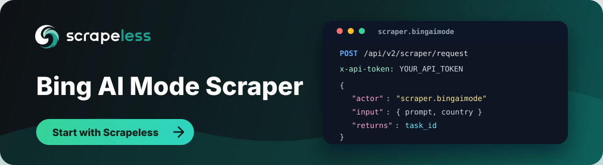

# Bing AI Mode Scraper

<p align="center">
  <a href="https://app.scrapeless.com/passport/login?redirect=/quick-start&utm_source=github&utm_medium=repo&utm_campaign=bing_ai_mode_scraper" target="_blank">
    
  </a>
</p>

<p align="center">
  <a href="https://app.scrapeless.com/passport/login?redirect=/quick-start&utm_source=github&utm_medium=repo&utm_campaign=bing_ai_mode_scraper">
    
  </a>
  <a href="https://www.scrapeless.com/en/blog?utm_source=github&utm_medium=repo&utm_campaign=bing_ai_mode_scraper">
    
  </a>
  <a href="https://x.com/Scrapelessteam">
    
  </a>
  <a href="https://www.linkedin.com/company/scrapeless/">
    
  </a>
</p>

Collect Bing AI Mode answers through the **Scrapeless AI Scraper** API. Each result can include the Markdown answer, the pages Bing cites, and product ads shown alongside the answer. Request rendered HTML when you need to inspect the page layout.

Use this repo to track which publishers Bing cites for a query and which retailers appear in ads for the same query.

- **Full documentation:** https://docs.scrapeless.com/en/docs/ai-scraper/scrapers/bing-ai-mode/
- **Get your `x-api-token`:** https://app.scrapeless.com/passport/login?redirect=/quick-start
- **API endpoint:** `POST https://api.scrapeless.com/api/v2/scraper/request`

## How it works

Submit your prompt to `scraper.bingaimode`, then use the returned `task_id` to fetch the answer. The commands below use curl and jq.

**Quick start**

Set `SCRAPELESS_API_TOKEN` to your dashboard token in the current shell. Submit the request and save the task ID.

```bash
export SCRAPELESS_API_TOKEN="your_api_token"

TASK_ID=$(curl --fail-with-body -sS 'https://api.scrapeless.com/api/v2/scraper/request' \
  -H "x-api-token: $SCRAPELESS_API_TOKEN" \
  -H 'Content-Type: application/json' \
  --data '{
    "actor": "scraper.bingaimode",
    "input": {
      "prompt": "What should I look for in a lightweight hiking backpack?",
      "country": "US"
    }
  }' | jq -er '.task_id')
```

**Request parameters**

| Input field | Type | Required | Description |
| --- | --- | --- | --- |
| `prompt` | string | Yes | Question to send to Bing AI Mode. |
| `country` | string | Yes | Country code, for example `US`. |
| `should_fetch_html` | boolean | No | Set to `true` to include the rendered HTML. |

**Retrieve the result**

Run the following command with the task ID from the first step. If the status is `pending` or `running`, wait a few seconds and repeat this GET request. On `success`, it prints the Markdown answer. On `failed`, it shows the error message.

```bash
curl -sS "https://api.scrapeless.com/api/v2/scraper/result/$TASK_ID" \
  -H "x-api-token: $SCRAPELESS_API_TOKEN" \
  | jq -r 'if .status == "success" then .task_result.content_md else {status, message} end'
```

**Response fields**

Read the following fields from `task_result` after the task succeeds.

| Field | Description |
| --- | --- |
| `prompt` | Original query. |
| `content_md` | Answer formatted as Markdown. |
| `content_raw` | Raw answer content. |
| `sources` | Cited pages, including each page’s URL and citation count. |
| `ads` | Product ads, with details such as seller, price and destination URL when available. |
| `html` | Rendered page when requested with `should_fetch_html`. |

**Code examples**

Set `SCRAPELESS_API_TOKEN` as shown above, then choose one language. Run the command without arguments to submit the sample question and print a task ID. To check that task, append the ID to the same command (for example, `python3 examples/example.py YOUR_TASK_ID`). If it prints `pending` or `running`, repeat the command **with the same ID**.

On success the example prints `content_md`, followed by the title and URL of each entry in `sources` when available.

| Language | File | Run from the repository root |
| --- | --- | --- |
| Python 3 | [example.py](./examples/example.py) | `python3 examples/example.py` |
| Node.js 18+ | [example.js](./examples/example.js) | `node examples/example.js` |
| Go | [example.go](./examples/example.go) | `go run examples/example.go` |
| Java 17+ with jq | [Example.java](./examples/Example.java) | `java examples/Example.java` |
| PHP 8+ with HTTPS streams | [example.php](./examples/example.php) | `php examples/example.php` |

## Practical use cases

### AI answer monitoring

Save `content_md` for a fixed set of product questions. Compare answers over time to see when Bing starts recommending a different product.

### GEO and SEO research

Run the same query with different country codes. Group `sources` by domain and compare which publishers Bing cites in each market.

### Competitor intelligence

For shopping queries, compare brands named in the answer with sellers listed in `ads`. Track citation counts and ad placements separately.

### Dataset and workflow automation

Store one record per task and one row per cited URL. Use the task ID to join citations back to the answer or to any product ads returned for that query.

## Why use Scrapeless for Bing AI Mode scraping?

| Benefit | What it means for your team |
| ------- | --------------------------- |
| One unified API | Query Bing AI Mode through the same Scrapeless AI Scraper workflow used for other AI answer engines. |
| Structured output | Analyze answer text, cited pages and shopping ads as separate fields. |
| Less maintenance | Avoid browser automation, UI selectors, proxy rotation, retries, and anti-blocking logic. |
| Region-aware analysis | Compare localized AI answers and source citations with country-level input. |
| Production integration | Fetch results by task ID or receive completed tasks at an HTTPS webhook. |

## FAQ

### What is Bing AI Mode Scraper?

Bing AI Mode Scraper is a Scrapeless AI Scraper actor that sends prompts to Bing AI Mode and returns structured answer data.

### Do I need to run a browser or proxy pool?

No. This repo shows how to call the Scrapeless API. Scrapeless handles the scraping workflow behind the API.

### Which modes or options are supported?

Supply `prompt` and `country`. To inspect the rendered page alongside the answer, add `"should_fetch_html": true` inside `input`.

### Can I get results asynchronously?

Yes. Add `"webhook": {"url": "https://your-domain.example/callback"}` alongside `actor` and `input`, using your own HTTPS endpoint. Scrapeless sends the final status and task ID to that endpoint, together with the result on success.

### Is this suitable for AI search visibility monitoring?

Yes. Compare `sources[].url` and `sources[].cited_count` across repeated queries to track when and how often Bing cites a page.

## Learn more

- [Scrapeless AI Scraper documentation](https://docs.scrapeless.com/en/docs/ai-scraper/scrapers/bing-ai-mode/)
- [Scrapeless dashboard](https://app.scrapeless.com/passport/login?redirect=/quick-start)
- [Scrapeless blog](https://www.scrapeless.com/en/blog)

## Contact us

Need help building a Bing AI Mode monitoring workflow or scaling AI answer collection?

- Join our [Discord](https://discord.gg/VU2vtbq7Q2).
- Contact us on [Telegram](https://t.me/scrapeless).
- For repo-specific issues or improvements, open an issue or pull request in this repository.
